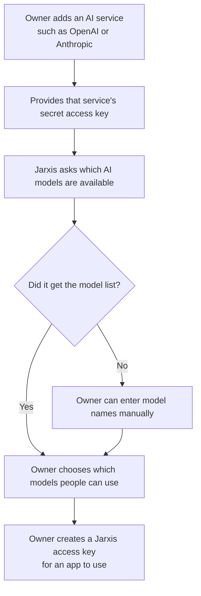
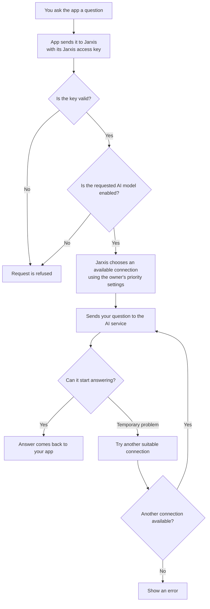
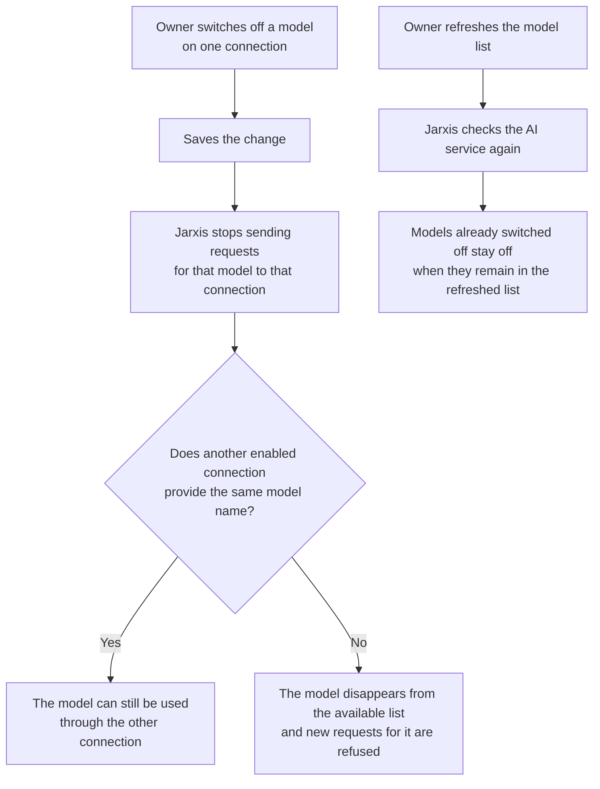

# Providers and shared model pools

## Plain-language guide

Think of Jarxis as a **reception desk for several AI services**. Your app sends a question to Jarxis, and Jarxis chooses an available connection to get an answer.

An **AI service** is a company such as OpenAI or Anthropic. A **model** is the particular AI you choose to answer your question. A **connection** is a saved way for Jarxis to reach an AI service.

### How the owner sets things up



There are **two different keys**. The AI service's key lets Jarxis talk to that service. The Jarxis key lets your app talk to Jarxis. The saved service key stays hidden; the full Jarxis key is shown only once when it is created.

### What happens when you ask a question



Jarxis can try another connection **only before the answer starts arriving**. If no connection is available to begin with, it returns an error. It also checks that the question is within its supported limits before sending it to an AI service.

The owner can group several connections under one model name. This is called a **model pool**: your app asks for one name, and Jarxis chooses a suitable connection behind the scenes.

### Switching models off and refreshing the list



Switching off a model on one connection does **not** switch it off on every other connection. To make a pooled model unavailable, switch it off on every connection that supplies it.

A refresh happens when the owner requests it, adds a connection with an access key, or replaces its key or service address. **There is no automatic hourly refresh.** If a refresh fails, Jarxis keeps the last successful model list.

## Connection setup and model management

Owners manage OpenAI, Anthropic, OpenRouter and custom HTTPS API-key connections and dedicated gateway keys in the Providers administration page. Subscription sign-in and OAuth account linking are not supported.

Discovery runs in the web request; no background worker is required. Set an independent `PROVIDERS_ENCRYPTION_KEY` (`ML_ENCRYPTION_KEY` remains a fallback) consisting of exactly 64 hex characters in the application; it must differ from the auth and JWT secrets. Keep it backed up securely: replacing it makes stored API keys unreadable. The application runs as the unprivileged node user, without vendor CLIs or a login-state volume.

Connection creation and credential or endpoint replacement await discovery after saving. Manual refresh also awaits discovery. Metadata edits do not discover; there is no hourly schedule or automatic retry. API-key providers read `data[].id` from `<baseUrl>/models`. Catalogs that cannot be discovered require owner-entered model identifiers.

Owners can turn models on or off in **Edit connection**. Search matches model names and IDs; **Enable all** and **Disable all** affect only current search results. The count shows enabled and total models. Changes remain in the editor until **Save connection** succeeds; **Cancel** discards them. Discovery retains the enabled state of models it has seen before. The provider card shows three models until **Show all** is selected. The add and edit API key fields start hidden and can be revealed temporarily with the eye button; closing the editor hides them again. Saved keys are never returned to the browser.

`PATCH /api/admin/providers/{id}/models` saves the complete model state and optional connection fields in one transaction. The connection listing supplies `modelStateVersion`; clients send it as `version` with `states`, an unpadded base64url string of enabled bits ordered by model ID, least significant bit first within each byte. The compact encoding keeps the payload within the 16 KiB body limit for a 5,000-model catalog. A changed catalog or concurrent model edit returns `409 MODEL_CATALOG_CHANGED`; reload models and review the selection before retrying. Each changed model receives an audit entry. The gateway immediately excludes disabled models from `/api/llm/v1/models` and inference routing.

## Upgrading from subscription connections

Stop the old app and worker before applying the removal migration. It permanently deletes Codex/Claude connections and their model mappings and drops all login jobs, including encrypted login state/input. API-key connections and audit history are preserved. Start the updated app after migration. Remove the old `jarxis_ml-worker-state` Docker volume once the old worker is stopped and detached; never use `docker compose down --volumes`, which also deletes database and Redis volumes. Remove obsolete vendor CLI and OAuth settings from deployment environments.

Catalog discovery is shared by the preview endpoint, connection creation, credential/endpoint updates and manual refresh. Each run uses the stored or supplied credential against a public HTTPS destination with no redirects, a 15-second total deadline across all pages, at most 2 MiB per response, 20 pages and 5000 unique models. A missing catalog endpoint (404, 405 or 501) is reported as `unsupported`; an empty list is a successful discovery; any other failure is `failed` with a generic message and never upstream text. Failed or unsupported runs keep the last successful catalog.

Before saving, owners can check an API-key provider with `POST /api/admin/providers/discover` (`providers:manage`, same origin and body limits as other mutations). It accepts `provider` (`openai`, `anthropic`, `openrouter` or `custom`), `apiKey` and an optional HTTPS `baseUrl` (required for `custom`) and returns `{ "discovery": { "status", "models": [{ "id", "name" }], "error" } }`. The key is not stored or logged. Creating an API-key connection commits it first, then awaits the same bounded discovery and returns the saved connection with `201` whether or not upstream discovery succeeded; the preview result is never trusted as input. If the request is interrupted, use manual refresh to retry. Discovery uses a revision claim under the connection lock, fetches outside the transaction and applies success or failure only when the revision, credentials, endpoint and connection state still match. Newer runs supersede older ones. Connections without a key stay pending until an API key is supplied.

## Access and errors

Provider access is owner only. `providers:read` and `providers:manage` belong only to the Owner role and are listed as owner-only in `src/lib/permissions.ts`, so `isAllowed` also requires the `owner` role. The page guard, every `/api/admin/providers` handler and the permission catalog use that same rule. Viewers and administrators do not see the navigation entry, are redirected away from the page, and get `403` from the API. Impersonated sessions and bearer tokens are rejected. Changing someone's role in Users changes their provider access immediately, because every request re-checks the owner's live session and role.

Management endpoints return `{ error: { code, message } }` with sanitized messages. A rejected custom endpoint (private, local, redirecting or non-HTTPS) returns `400 INVALID_ENDPOINT`. The panel reads only the status and an allowlisted error code (`src/lib/providers/errors.ts`) and never displays server text. Failures of page actions such as enabling, refreshing, deleting connections appear as a single toast. Failures inside a dialog appear inline in that dialog. Load and background-refresh failures show a page alert with a retry.

## API Keys administration

Manage gateway keys at `/admin/api-keys` under General. Providers now manages connections and models only. The API Keys page independently queries `/api/admin/providers/keys`, with name/prefix search, Active/Revoked filtering, creation-time sorting and pagination. It uses the same owner, live-session and `providers:read`/`providers:manage` guards as Providers.

`GET /api/admin/providers/keys` returns `{ keys, total, page, pageSize }`; `GET /api/admin/providers/keys/{keyId}` returns `{ record }`. Metadata includes the prefix, creation, last-use and revocation timestamps, without hashes or plaintext. `POST` reveals the full key once; the creation panel clears it on close and never adds it to query caches. `PATCH /api/admin/providers/keys/{keyId}` accepts only `{ name }` for active keys and atomically records `providers:key:rename`. `DELETE` revokes immediately and retains the record; the UI calls this Revoke. Revoked keys cannot be renamed (`409 API_KEY_REVOKED`). No database migration is required.

## Gateway

Gateway keys are independent of browser sessions and belong to their issuing owner. The gateway exposes `GET /api/llm/v1/models`, `POST /api/llm/v1/chat/completions` and `POST /api/llm/v1/responses`, authenticated with `Authorization: Bearer jml_...`. Keys are rate limited to 60 requests per minute.

Model identifiers are exact upstream IDs by default (including vendor segments such as `openai/gpt-4.1`), or owner-defined aliases. `/models` lists each advertised pool ID once with `owned_by: "jarxis"`. Requests pool across enabled, ready connections on every provider/endpoint. Lower numeric priority wins; healthy keys within a tier rotate per application process, with lower tiers used only on failure. Counters reset on restart and are independent across replicas. Cooldown temporarily excludes a key from routing without removing its model from the catalog.

Owners manage aliases per connection/model in **Model pools**, alongside member upstream IDs, priorities and availability. `PATCH /api/admin/providers/{id}/models/{modelId}/alias` accepts `{ "alias": "gpt-4.1", "version": "<modelStateVersion>" }`; `alias: null` removes it. Aliases are trimmed, 1–200 characters, use the model-ID character set and cannot contain `/`. The endpoint is owner-only, records actual changes as `providers:model:alias`, and returns `{ connection }`. Stale versions return `409 MODEL_CATALOG_CHANGED`. Discovery preserves aliases and enabled flags on surviving model records. Model DTOs retain `publicId` for the legacy ID and add `alias`/`poolId`; the connection list includes pool summaries.

Legacy `<namespace>/<upstream ID>` IDs, including endpoint-hashed custom namespaces, retain their original connection scope and take precedence over conflicting pool names. A conflicting pool is not advertised; its owner view shows **Alias required**. Explicit aliases merge differing upstream IDs without changing what is forwarded upstream. Unknown or disabled models return `404 MODEL_NOT_FOUND`; known pools with no available connections return sanitized `502 UPSTREAM_UNAVAILABLE`. Provider-specific unsupported features are filtered before upstream calls; if no available candidate supports the request the gateway returns 400. Client responses and stream frames retain the requested ID.

```bash
export JML_KEY=jml_REPLACE_ME
curl -s https://app.example.com/api/llm/v1/models -H "Authorization: Bearer $JML_KEY"
curl -s https://app.example.com/api/llm/v1/chat/completions \
  -H "Authorization: Bearer $JML_KEY" -H 'Content-Type: application/json' \
  -d '{"model":"gpt-4.1","messages":[{"role":"user","content":"Hello"}]}'
curl -s https://app.example.com/api/llm/v1/responses \
  -H "Authorization: Bearer $JML_KEY" -H 'Content-Type: application/json' \
  -d '{"model":"gpt-5","input":"Hello","stream":true}'
```

Protocol limits, enforced before any upstream call:

- Requests are JSON only, at most 1 MiB, and time out after 120 seconds. `model` is at most 512 characters; at most 512 messages or input items and 128 tools.
- Unknown fields are rejected. Chat rejects `functions`, `function_call`, `logit_bias`, `logprobs`, `top_logprobs`, `seed`, `service_tier`, `store`, `audio`, `modalities`, `prediction`, `web_search_options`, `reasoning_effort`, `frequency_penalty`, `presence_penalty` and any `n` other than 1.
- Responses is stateless: `store` must be false or omitted, and `previous_response_id`, `conversation`, `background`, `include`, `truncation`, `reasoning`, `prompt`, `prompt_cache_key`, `safety_identifier`, `service_tier`, `logprobs`, `top_logprobs` and `max_tool_calls` are rejected. Only function tools are accepted.
- Image input is rejected for every provider.
- Anthropic rejects structured output, `user`, strict tools and `temperature` above 1.
- Failover across pooled connections happens on credential failures, transport errors, 401, 429 and 5xx, only before the first output byte. 429 responses set a cooldown from `Retry-After` or rate-limit reset headers (minimum one minute); 401 also marks the connection for reconnection. Upstream error bodies are never returned.

## Naming and upgrade compatibility

Use `/admin/providers` and `/api/admin/providers`. The old admin URL redirects while retaining query parameters; old management API paths share the same guarded handlers. Both `providers-worker` and `ml-worker`, their package commands and the Docker worker target have been removed.

Set `PROVIDERS_ENCRYPTION_KEY` to the existing 64-character hex key. `ML_ENCRYPTION_KEY` remains a fallback; conflicting nonempty values are rejected. Local environment preparation copies an existing legacy value instead of rotating it. Stored ciphertext retains its connection-ID authentication context.

Prisma uses `ProviderConnection`, `ProviderModel` and `ProviderGatewayKey` while physical SQL names remain `ml_connections`, `ml_models` and `ml_gateway_keys`. Existing public model IDs, `jml_` gateway keys, lock hashes and Redis coordination namespaces stay valid across rolling upgrades. New provider audit events use `providers:*`; historical `ml:*` rows remain intact.

## Deploying the worker-free pool release

Drain the old application and stop both worker service names before applying the pool migration. It adds model aliases and `discovery_revision`, and removes the scheduling timestamp/index; model rows, credentials, enabled selections and audit history are retained. Start the new application and verify plain/legacy requests, aliases and synchronous refresh. Never remove PostgreSQL/Redis volumes or rotate credential encryption keys for this upgrade. To roll back, drain the new application first, back up alias values, restore the old scheduling field/index and schema, and only then restart the older app/worker. Keep historical migrations unchanged.
